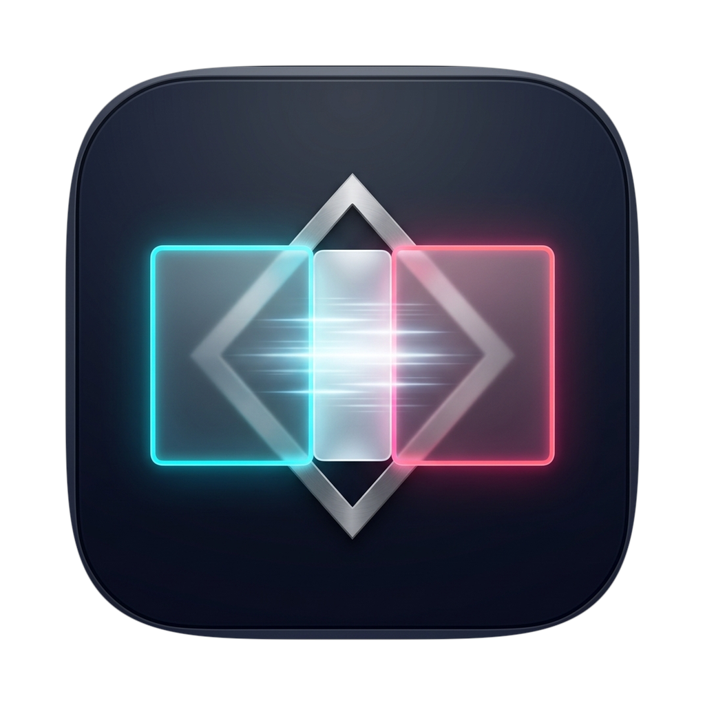
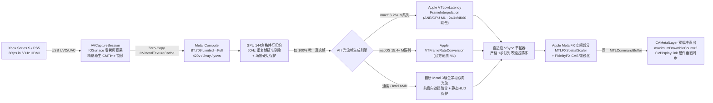

<p align="center">
  
</p>

<h1 align="center">GTA6-MetalFX (CM716FX)</h1>

<p align="center">
  <strong>Open-Source macOS Hardware-Accelerated Super-Resolution &amp; AI Frame Generation Engine for GTA 6 &amp; 30fps Console Gaming via HDMI Capture Cards</strong>
  <br />
  面向 <strong>GTA 6（Xbox Series S/X · PS5）</strong> 与 30fps 主机游戏的 macOS 原生零拷贝 <strong>MetalFX 空间超分 + Apple AI 帧生成</strong> 开源引擎
</p>

<p align="center">
  
  
  
  
</p>

---

## 🎯 项目初衷 / Why CM716FX?

**GTA 6** 在 Xbox Series S / X 与 PS5 主机端以 **30fps** 为基准帧率（尤其 Xbox Series S 动态内部分辨率较低、激烈场景会掉到 24–28fps）。
在 macOS 上用采集卡玩主机并开启传统外挂插帧（`OBS / QuickTime → WindowServer → ScreenCaptureKit → 第三方插帧叠层`）存在三重致命缺陷：

1. **双重抓屏拷贝延迟**：OBS 渲染 + 系统合成器 + ScreenCaptureKit 再次抓屏，白白多吃 1–2 帧延迟。
2. **60Hz 容器“重复帧杀手”**：主机 30fps 游戏在 60Hz HDMI 信号中以 `A, A, B, B` 形式传输，通用插帧器直接吃进重复帧会导致光流矢量错乱、果冻鬼影与画面抽搐。
3. **UVC 采集卡硬件暗坑**：如绿联 **CM716（料号 25854）** 上报精确的 `1000000/60000240` 离散帧间隔，且 USB 2.0/3.0 色域与 `2vuy`/`yuvs`/`420v` 极易被通用播放器误配置导致发灰、压缩块或崩溃。

**CM716FX** 采用**单进程原生 Swift + Metal + VideoToolbox 架构**，彻底移除 OBS 与 ScreenCaptureKit 中转层，把 30fps 主机画面低延迟升级为丝滑 **60fps / 120fps** 并超分至 **4K / Retina 5K**！

---

## ⚙️ 底层硬件级优化剖析 / Low-Level Hardware Optimizations

> **实事求是的工程边界**：CM716FX 不刷写采集卡固件、也不替换系统 UVC 内核驱动（免驱即插即用）；它的优化深度直达 **macOS 用户态可触及的最低硬件与 GPU 管线层**：



* **零拷贝 `IOSurface` DMA 内存共享**：`AVCaptureVideoDataOutput` → `CVMetalTextureCache` → `VTFrameProcessor` → `MTLFXSpatialScaler` 全程复用同一块 GPU/统一显存，无一次 CPU `memcpy`。
* **MacroSilicon / UGREEN CM716 原生 `CMTime` 硬件锁帧**：直接对齐采集卡硬件离散周期（如 `1000000/60000240` 与 `1000000/30000030`），彻底消除帧率协商异常与抖动。
* **GPU Threadgroup 共享内存并行去重 + 局部峰值检测**：144 宫格亮度+色度联合 MAD（`< 0.4ms`），既能 100% 过滤 60Hz 重复帧，又不会误杀静止镜头下远处移动的车辆/准星；场景硬切自动跳过插帧防鬼影。
* **单 `MTLCommandBuffer` 融合编排**：将 Apple **`VTLowLatencyFrameInterpolation`**（macOS 26+ 原生 ML 帧生成，支持单次 `1080p30 → 4K60` 联合 AI 超分+插帧）与 **`MTLFXSpatialScaler`** 串在同一命令缓冲区执行，避免 CPU/GPU 反复同步等待。
* **静态 HUD 保护（针对 GTA 6 小地图与准星）**：在自研 Metal 金字塔双向光流中自动识别跨帧静止 UI 像素并衰减光流形变，大幅减轻小地图与字幕边缘撕裂。
* **双形态（独立引擎 / Adrenaline 伴侣模式）**：按 `M` 或 `4` 一键切至纯净 30fps 去重直出窗口，可作为 Mac App Store `Adrenaline: Frame Generation` 的零重复帧超低延迟伴侣。

---

## 📊 实机 GPU 压测数据 / Benchmarks

运行 `./CM716FX.app/Contents/MacOS/CM716FX --self-test`（模拟 CM716 1080p 60Hz 含 50% 重复帧 + 日夜硬切）：

| 测试平台 | 架构 / 系统 | 重复帧剔除精度 | 场景硬切保护 | GPU 转换+去重 | 1080p 插帧耗时 | MetalFX 1080p→4K | 60fps 实时预算（16.67ms） |
| :--- | :--- | :---: | :---: | :---: | :---: | :---: | :---: |
| **iMac Pro (2017)**<br/>Radeon Pro Vega 56 8GB | `x86_64`<br/>macOS 15.8.3 | **30 / 30 (100%)** | **PASS** | `0.37 ms` | `3.73 ms`<br/>*(Metal 双向光流)* | **`1.86 ms`**<br/>*(原生 MetalFX)* | **`5.96 ms`（PASS）** |
| **Apple Silicon M2** | `arm64`<br/>macOS 15 / 26+ | **支持** | **支持** | 原生统一内存 | **Apple VT AI / 光流** | **Apple MetalFX / VT AI SR** | 欢迎社区提交 PR 补充实测数据 |

---

## 🔌 采集卡与主机最佳配置 / Hardware Setup (GTA 6 Ready)

### 1. 实机已验证采集卡
* **绿联 CM716（料号 `25854`，MacroSilicon `bcdUSB 2.0 / 480 Mb/s`）**：
  - 默认锁 `1920x1080 [420v] @ 60fps + GPU 去重`（低相位延迟、抗掉帧）；
  - 按 **`C`** 键可切 `1920x1080 [420v] @ 30fps`（在 USB 2.0 480Mbps 下**单帧码率直接翻倍**，画质压缩噪点更少）。
* **通用 UVC 采集卡**：支持所有免驱 USB 3.0 / 2.0 UVC 采集卡（MS2130、Elgato 4K X/S、圆刚、ShadowCast 等），优先协商无压缩 `NV12` / `YUY2`。

### 2. Xbox Series S / PS5 低延迟游玩黄金法则
1. **手柄直连主机**：主机与 Mac 在同一房间时，**手柄直接配对连 XSS/PS5（Xbox Wireless ~5–8ms）**，切勿连 Mac 蓝牙回传！
2. **主机显示设置**：输出设为 **`1080p @ 60Hz`**（匹配 CM716 最大采集分辨率，避免卡内缩放延迟）、**关闭 HDR10**、色彩空间选 **`标准 (Limited 16–235)`**。
3. **音频**：CM716 自动低延迟直通 24-bit/48kHz HDMI 声音；如果耳机插手柄直听主机，按 **`A`** 将电脑端静音即可。

---

## 🚀 快速开始 / Quick Start

### 方式一：本地一键编译 Universal 2（`arm64` + `x86_64`）

需要 macOS 14+ 与 Xcode Command Line Tools（`xcode-select --install`）：

```bash
git clone https://github.com/Yangstud/GTA6-MetalFX.git
cd GTA6-MetalFX
chmod +x build_app.sh check_cm716.sh
./build_app.sh
```

构建完成后直接双击生成的 `CM716FX.app` 即可运行（也可直接拷贝至 M2 / M3 / M4 Mac 运行）。

### 方式二：无采集卡离线体验
未连接采集卡时，打开 `CM716FX.app` 会自动进入 **内置 1080p 30fps 罪恶都市霓虹公路测试画面**（模拟 60Hz 重复帧 + 偶发掉帧 + 日夜硬切 + 静态小地图），随时可按 `1`–`5` 或 `G` / `U` / `D` 肉眼对比效果。

---

## ⌨️ 快捷键 / Hotkeys

| 按键 | 功能 |
| :--- | :--- |
| `1` | 预设 1：**GTA 6 · 推荐平衡**（60Hz + GPU去重 → Apple AI 2x / 光流 2x + MetalFX + CAS 28%） |
| `2` | 预设 2：**GTA 6 · M2 4K60 联合 AI**（macOS 26+：`1080p30 → 4K60` 单次 ML 超分+插帧） |
| `3` | 预设 3：**GTA 6 · 120Hz 高刷**（`30→120fps` 4x 插帧 + MetalFX，适配 ProMotion / 120Hz 屏） |
| `4` / `M` | 预设 4：**Adrenaline 纯净 30fps 喂帧伴侣**（GPU 去重直通、关内置插帧/超分、自动藏 HUD） |
| `5` | 预设 5：**原始采集对比**（关闭插帧与超分，实时 A/B 对比） |
| `G` / `Space` | 轮换帧生成引擎（OFF / AUTO / VT AI 2x / VT AI 4x / VT 4K60 联合 / VT FRC / Metal 光流） |
| `U` | 轮换超分引擎（AUTO / MetalFX 空间超分 / VT AI 低延迟超分 / CAS 双三次 / OFF） |
| `D` | 开关 GPU 60Hz 重复帧剔除 |
| `C` | 切换采集规格：`1080p60 + 去重` ↔ `1080p30 高单帧码率` |
| `S` | 调节 FidelityFX CAS 微锐化（`0% / 25% / 50% / 75%`） |
| `R` | 切换 HDMI 色域（`Limited 16-235` ↔ `Full 0-255`） |
| `A` | HDMI 声音直通静音切换 |
| `T` | 开关内置 1080p 30fps 测试画面 |
| `F` / `Esc` | 无边框全屏切换 |
| `H` / `Tab` | 显示 / 隐藏左上角实时性能 HUD |

---

## 🤝 参与贡献 / Contributing

欢迎提交 Issue 或 PR 共建 **GTA 6 主机开源帧率与画质优化生态**！详见 [CONTRIBUTING.md](CONTRIBUTING.md)。

## 📄 License

本项目采用 [MIT License](LICENSE) 开源协议。
